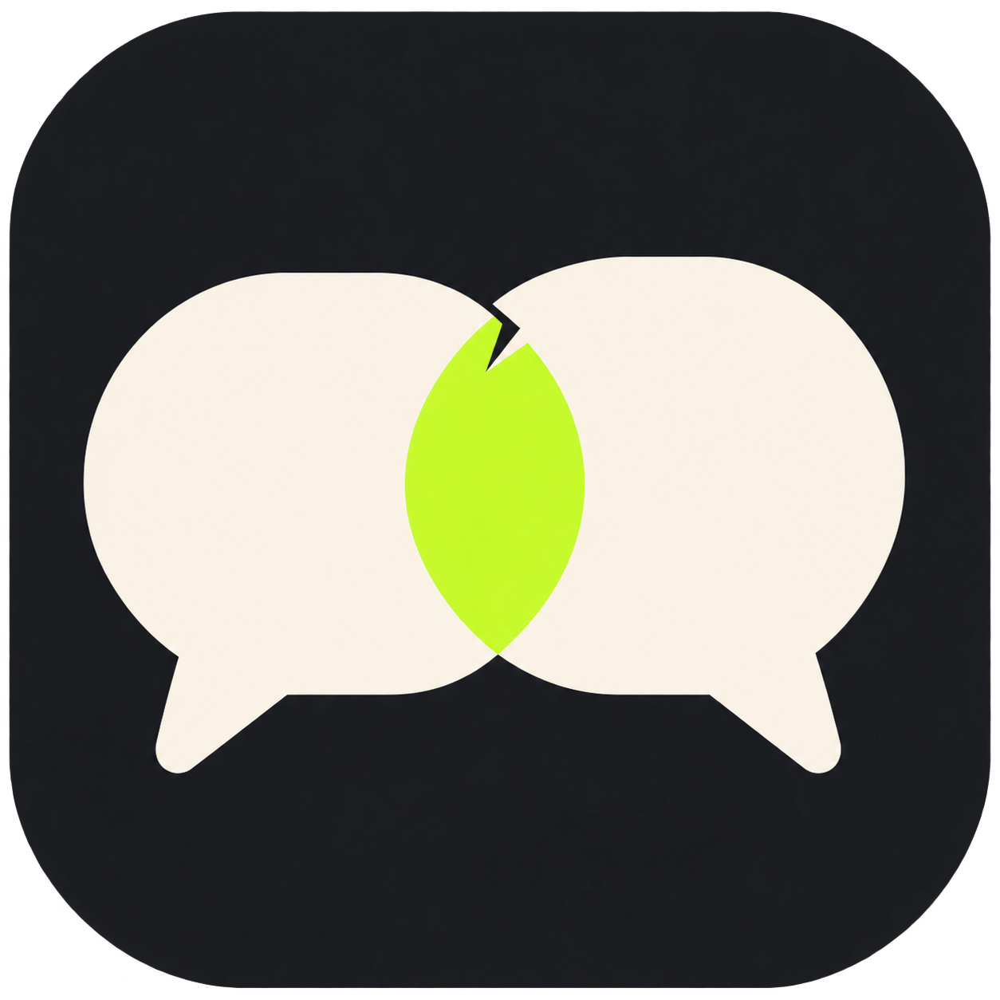
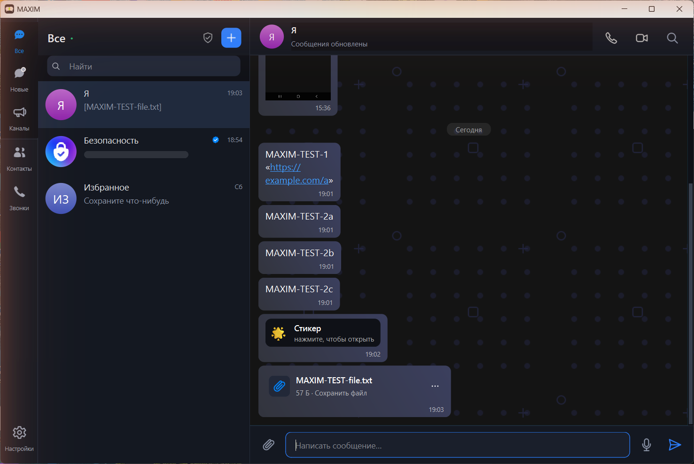
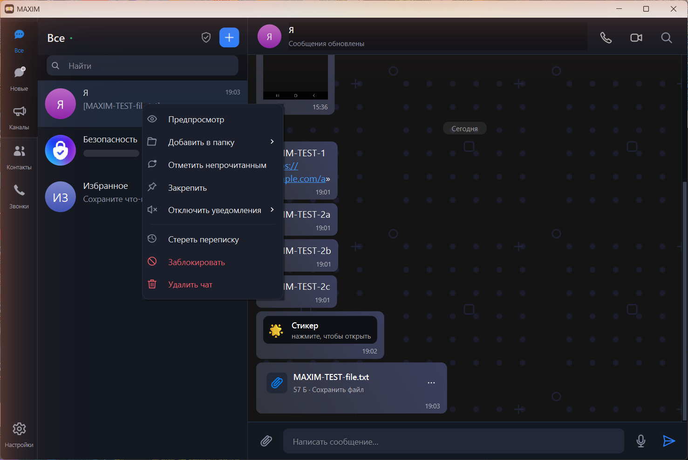
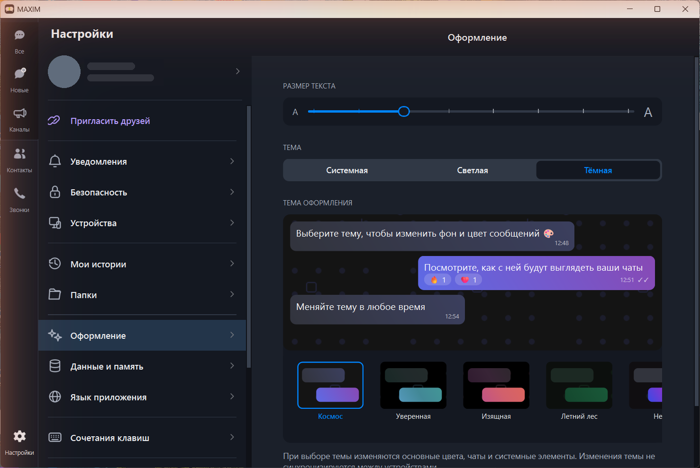

# MAXIM



MAXIM - настольный клиент MAX для Windows на Python и PySide6. Если у вас есть своя действующая сессия, можно открыть чаты в отдельном приложении с чёрно-лаймовой иконкой.

Это экспериментальная версия, не связанная с разработчиками MAX. Серверный протокол может измениться, поэтому отдельные действия пока работают не во всех чатах.

## Скачать и запустить

### Готовая программа для Windows

1. [Скачайте ZIP с готовой программой](https://github.com/sansmaster1982/max-desktop/releases/download/v1.1.0-alpha.3/MAXIM-1.1.0-alpha.3-windows-x64.zip).
2. Распакуйте ZIP в любую папку. Не запускайте EXE прямо из архива.
3. Откройте `MAXIM.exe` в распакованной папке. Рядом с ним должна оставаться папка `_internal`.

Эту же сборку можно посмотреть в папке **[MAXIM-Windows](MAXIM-Windows/)** в корне репозитория. Для скачивания удобнее ZIP: GitHub не даёт скачать папку одной кнопкой. [Страница выпуска](https://github.com/sansmaster1982/max-desktop/releases/tag/v1.1.0-alpha.3) содержит файлы и сведения об их проверке. Старые `MAX Desktop.exe` относятся к историческим версиям.

### Запуск из Python

Понадобятся Windows x64 и Python 3.11. Скачайте [ZIP с исходным кодом MAXIM](https://github.com/sansmaster1982/max-desktop/releases/download/v1.1.0-alpha.3/MAXIM-1.1.0-alpha.3-source.zip) и распакуйте его. В папке с файлом `run.py` откройте PowerShell и выполните:

```powershell
py -3.11 -m venv .venv
.venv\Scripts\python.exe -m pip install -r requirements.txt
.venv\Scripts\python.exe run.py
```

Если команда `py -3.11` не находится, установите Python 3.11 для Windows. Исходный код есть и в этом репозитории. Папка автоматических тестов не входит в пользовательский пакет; результаты проверок указаны в выпуске. Для сборки собственного EXE см. [BUILDING.md](BUILDING.md), планы развития — в [ROADMAP.md](ROADMAP.md).

Используйте свои аккаунты и сессии. Перед запуском закройте старую сборку, использующую ту же папку данных. Новая версия запрещает одновременную работу двух процессов с одной папкой. Выход из аккаунта и удаление каталога данных — разные действия.

## Скриншоты







## Что уже работает

- Можно восстановить свою сохранённую сессию или войти со своим действующим токеном. Штатные экраны входа по SMS и QR показываются, когда их предлагает сервер.
- Приложение загружает список чатов, историю сообщений и новые события. В переписке доступны текст, поддерживаемые вложения и действия, результат которых подтверждён сервером.
- Есть поиск и карточки контактов. Открываются профиль, оформление, уведомления, список устройств и доступные настройки безопасности.
- Интерфейс переведён на русский, английский, испанский, португальский (Бразилия), французский, узбекский и белорусский. Часть надписей ещё остаётся на русском.

## Что ещё в работе

Звонков и видеосвязи в этом выпуске нет. В готовый EXE также не включены встроенные веб-приложения MAX: их исходный модуль сохранён, но для бинарной сборки нужны дополнительные проверки. Шифрование сообщений через Dark Message пока запланировано, переключателя шифрования в чатах ещё нет.

Доступность команд зависит от типа чата, прав и ответа сервера. Неопределённый результат операции показывается отдельно; он не считается подтверждённым успехом. Сохранённый токен не даёт возможности обходить SMS, 2FA или ограничения сервера. QR-вход не означает перенос сессии в обычное приложение на другом телефоне. Скрытые коды мобильного мини-приложения здесь не обещаются.

Первый portable-выпуск не включает движок Chromium/QtWebEngine. Встроенные веб-мини-приложения будут возвращены в бинарную сборку после проверки их поведения и полного комплекта уведомлений сторонних компонентов.

## Сборка собственного EXE

Для сборки нужен Python 3.11.9 на Windows x64. Команды и зафиксированные версии зависимостей приведены в [BUILDING.md](BUILDING.md). Для обычного запуска из Python достаточно трёх команд выше.

Укажите каталог данных через `MAX_DESKTOP_DATA_DIR`, если нужен отдельный профиль. По умолчанию используется `%APPDATA%\MAX Desktop`, чтобы сохранить совместимость с прежним клиентом. Рабочая сессия и кэш не включаются в релизы.

## Приватность

Клиент соединяется с инфраструктурой MAX; транспортное TLS-шифрование не является сквозным шифрованием переписки. Токен, сведения профиля и кэш хранятся на компьютере. Не публикуйте каталог данных, дампы, логи с содержимым сообщений или снимки с токенами. В текущем клиенте локальный токен не защищён отдельным шифрованным хранилищем ОС.

Для диагностики сначала удаляйте личные данные. Не вставляйте токены в GitHub Issues и не публикуйте полный вывод хранилища браузера. При недействительном токене нужен обычный повторный вход; клиент не гарантирует срок жизни сессии или отсутствие ограничений аккаунта.

## Dark Message и развитие

План интеграции: [ROADMAP.md](ROADMAP.md). Исходный проект: **[Dark Message](https://github.com/sansmaster1982/dark-message)**.

Для MAXIM планируем переключатель в чате: включили его - текст и файл шифруются на компьютере, а собеседник получает контейнер `.darkm`. Перед этим нужно проверить совместимость формата и исправить работу с ключами и временными файлами. Сервис передачи всё равно будет видеть, кто и когда общается.

Сам **Dark Message** уже существует отдельно от MAXIM. Его можно [скачать для Android в RuStore](https://www.rustore.ru/catalog/app/com.darkmessage.app) или [для iPhone и iPad в App Store](https://apps.apple.com/ru/app/dark-message-crypto-chat/id6760596467). [Исходный код Dark Message](https://github.com/sansmaster1982/dark-message) открыт на GitHub. Эти мобильные приложения шифруют текст и файлы; они не являются мобильной версией MAXIM.

Также планируем добавить **аудиозвонки и видеозвонки**. После стабилизации настольного клиента выпустим отдельные версии **MAXIM для Android и iPhone** на Flutter. Сейчас мобильной версии MAXIM нет; этапы работы описаны в [плане развития](ROADMAP.md).

## Происхождение и лицензии

Код проекта распространяется по [MIT](LICENSE); библиотеки и другие сторонние компоненты сохраняют собственные лицензии. Клиент развивался с использованием прежнего настольного клиента, `test5` и исследований протокола; он не написан полностью с нуля. Подробности о компонентах и исключённых ресурсах — [THIRD_PARTY_NOTICES.md](THIRD_PARTY_NOTICES.md). Названия и торговые марки MAX принадлежат их владельцам.

## Поддержать проект

**[Поддержать банковской картой](https://yoomoney.ru/to/410011004366707)** через ЮMoney. Укажите сумму и выберите способ перевода «Банковская карта».

Также можно поддержать проект криптовалютой:

| Валюта | Сеть | Адрес |
| --- | --- | --- |
| **BTC** | Bitcoin | `bc1qs5fly0u7fa9dgg2dmlzqf82ttxvwy2hl68g059` |
| **ETH** | Ethereum, ERC-20 | `0x7a36d08EF5dC64dDC50a5687A9F209CC72e857d5` |
| **USDT** | TRON, TRC-20 | `TVfxWMieo8xUGu73FjGR6Xb7Q3atYgUMr3` |
